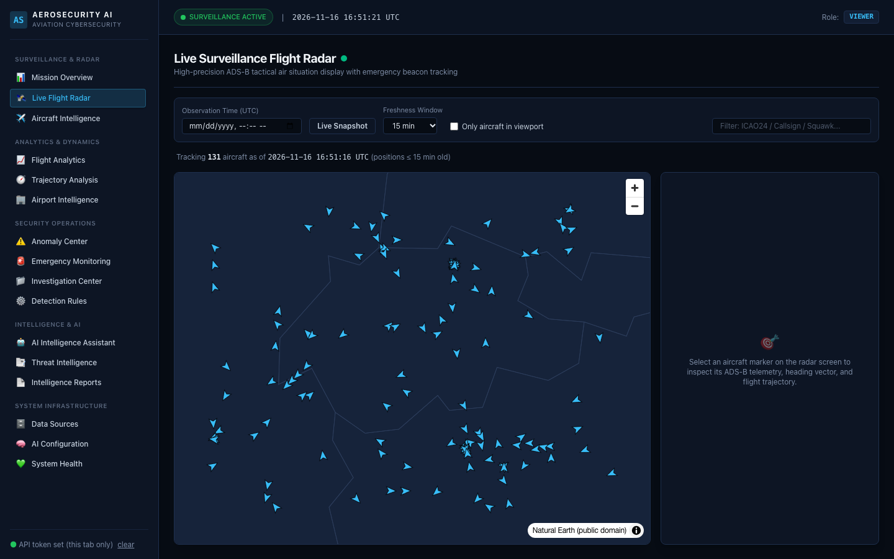
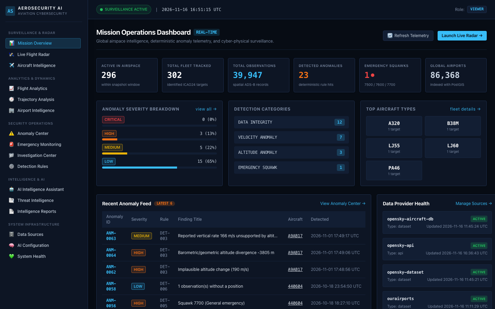
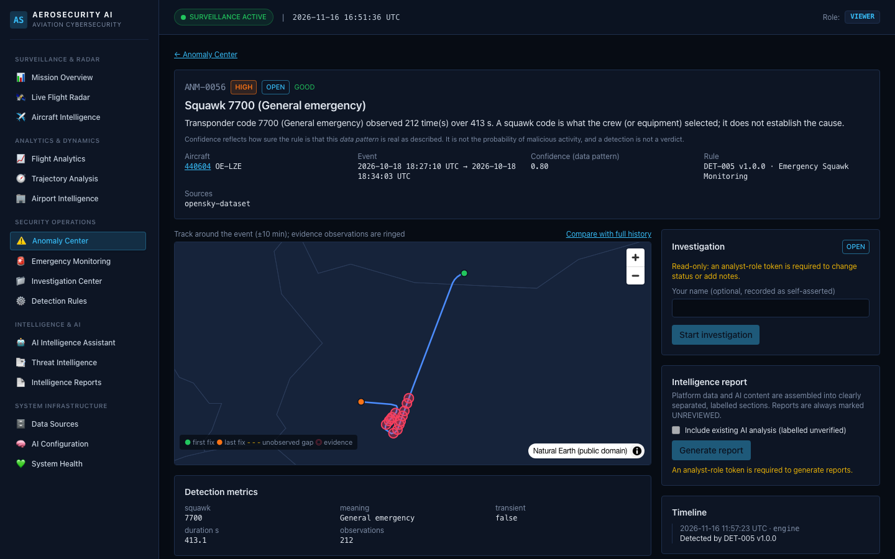
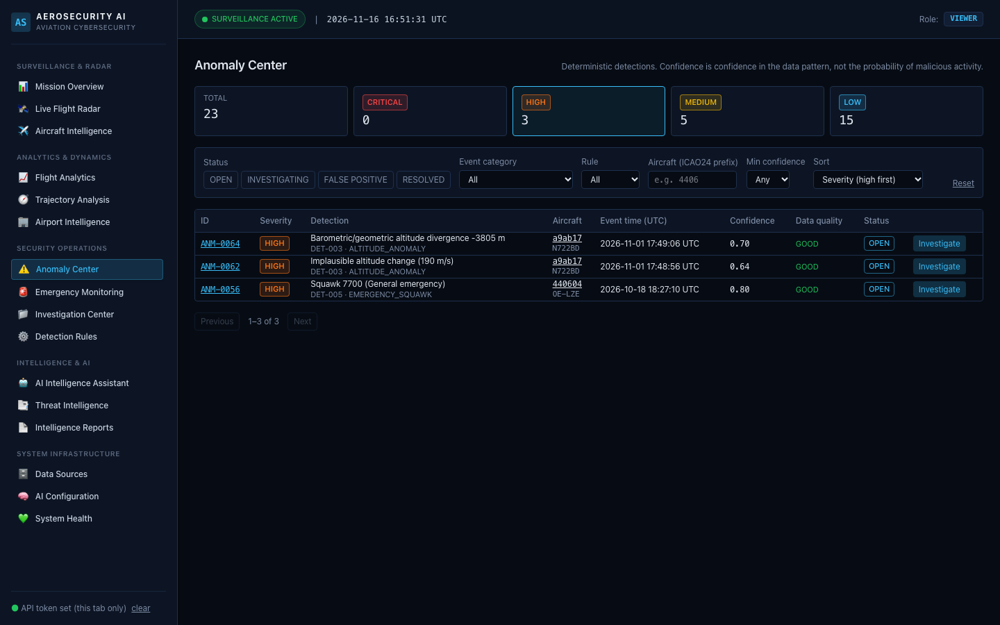
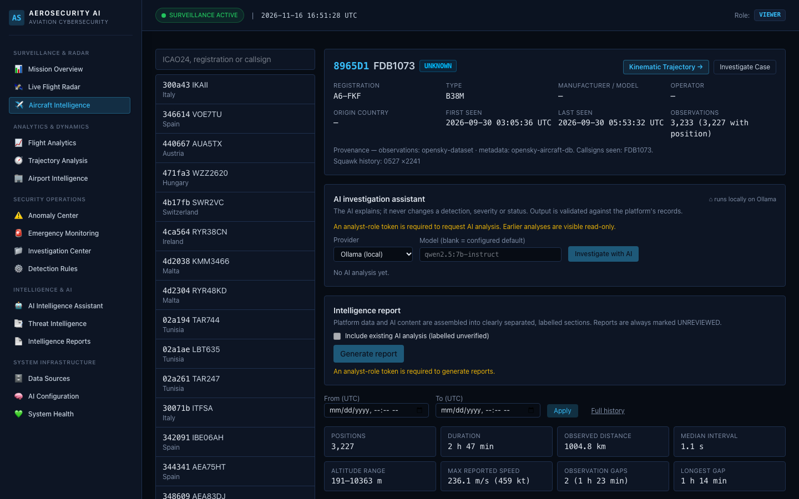
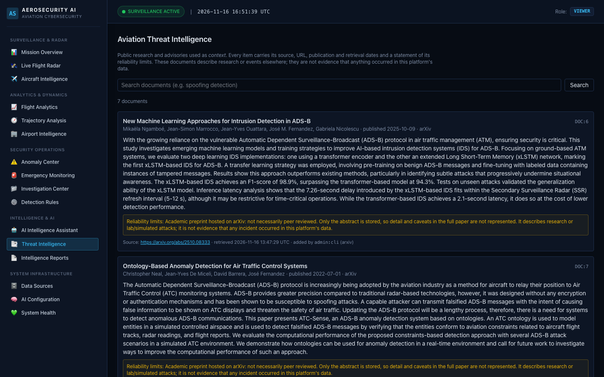
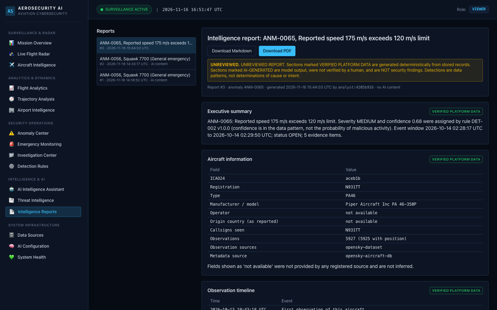
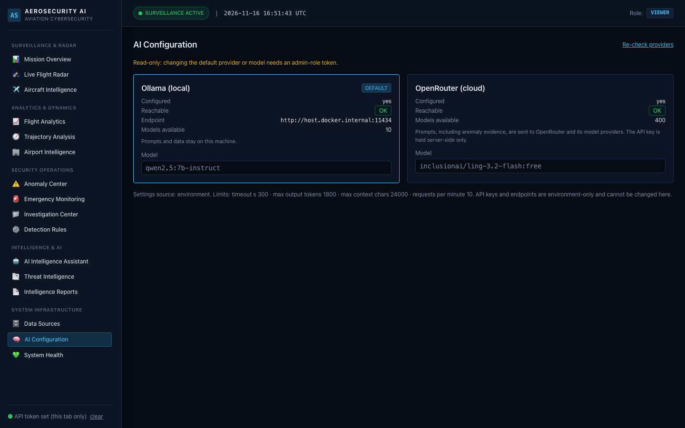
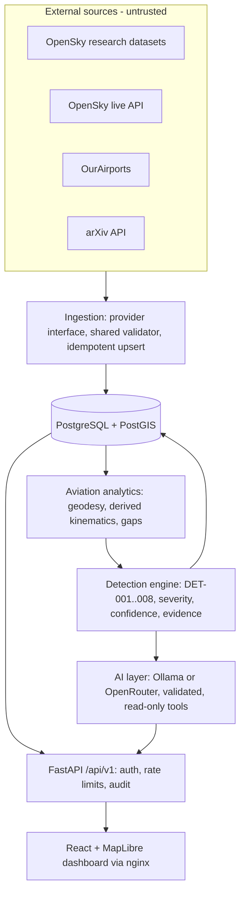
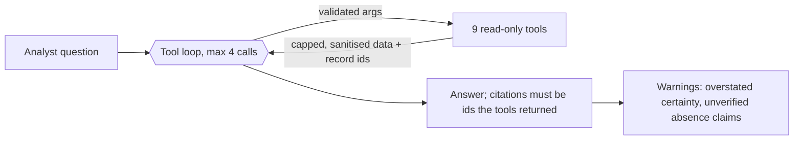

# AeroSecurity AI

> *Monitor the skies. Detect anomalies. Investigate aviation intelligence.*

An aviation intelligence and cybersecurity analytics platform. It ingests real, publicly available ADS-B observations, runs **deterministic, evidence-backed detection rules** over them, and gives analysts an investigation workflow with **AI assistance that explains but never decides**.

Designed and developed as a security-engineering portfolio project: **Python, FastAPI, PostgreSQL/PostGIS, React, Ollama and OpenRouter.**

| Live radar (real OpenSky data) | Mission overview |
|---|---|
|  |  |

| Emergency squawk 7700 investigation | Anomaly Center |
|---|---|
|  |  |

<details><summary>More screenshots</summary>

| Aircraft track with observation gap | Threat intelligence | Report | AI configuration |
|---|---|---|---|
|  |  |  |  |

</details>

> **What this is not.** It is not an aircraft control system, a safety-certified product, or an attack-attribution tool. A detection is a *data pattern* worth a human's attention, never a finding of cause or intent. **No detection-accuracy claim is made**: nothing has been validated against labelled attack data.

---

## Contents
[Problem](#problem-statement) · [Objectives](#objectives) · [Architecture](#architecture) · [Tech stack](#technology-stack) · [Modules](#core-modules) · [Data](#data-sources) · [Detection](#detection-engineering) · [AI](#ai-integration) · [Database](#database) · [Quick start](#quick-start) · [Configuration](#configuration) · [API](#api) · [Testing](#testing) · [Security](#security-considerations) · [Decisions](#cybersecurity-engineering-decisions) · [Limitations](#known-limitations) · [Roadmap](#roadmap)

## Problem statement
ADS-B is unauthenticated and unencrypted: anyone can transmit a message claiming to be any aircraft. Public receiver networks make the resulting data widely available, but raw state vectors are noisy, incomplete and full of benign oddities (clock jitter, receiver gaps, decoding errors). Security analysts need to separate *data-integrity noise* from *genuinely suspicious patterns*, see exactly which observations support an alert, and record what they concluded and why. Generic dashboards don't do this, and LLM wrappers that "detect anomalies" can't show their evidence or be reproduced.

## Objectives
- Turn raw observations into **explainable, reproducible** detections: every finding carries its evidence, the tolerances used, and the benign alternatives.
- Keep **confidence in the data pattern** strictly separate from any claim about malicious intent.
- Support a real **analyst workflow**: triage, investigate, annotate, close with a reason, all audited.
- Use AI where it helps (explanation, retrieval, drafting) with **hard guardrails**: validated output, grounded citations, no write access, clear labelling.
- Be honest about data provenance and limits.

## Architecture



A **modular monolith**: one backend process, one database, one SPA. Business logic lives in `backend/app/services` and the rule modules; route handlers stay thin; **the frontend never computes a verdict**. See [`docs/architecture.md`](docs/architecture.md) and [`docs/engineering-decisions.md`](docs/engineering-decisions.md).

## Technology stack
| Layer | Technology |
|---|---|
| Backend | Python 3.12, FastAPI, Pydantic v2, SQLAlchemy 2, Alembic, httpx |
| Data | PostgreSQL 16 + PostGIS 3.4 (GiST spatial indexes, JSONB evidence) |
| Frontend | React 19, TypeScript, Vite, Tailwind CSS, MapLibre GL, Recharts, TanStack Query |
| AI | Ollama (local) and OpenRouter (cloud) behind one `LLMProvider` interface |
| Reports | ReportLab (PDF), escaped Markdown |
| Quality | pytest, Ruff, mypy (strict), Bandit, pip-audit, Vitest, Playwright |
| Deploy | Docker Compose, nginx (unprivileged), non-root containers |

Dependencies were added only when used: no Kubernetes, Kafka, Redis or vector database.

## Core modules
| Area | Pages |
|---|---|
| Surveillance | Mission Overview · Live Flight Radar (live or replay any stored moment) · Aircraft Intelligence (search, track, charts, timeline) |
| Analytics | Flight Analytics · Trajectory Analysis (reported vs derived speed, gaps) · Airport Intelligence |
| Security operations | Anomaly Center (filters, evidence, notes) · Emergency Monitoring (7500/7600/7700) · Investigation Center · Detection Rules |
| Intelligence & AI | AI Intelligence Assistant (tool-using chat) · Threat Intelligence · Reports (Markdown/PDF) |
| System | Data Sources · AI Configuration · System Health |

## Data sources
| Source | Used for | Licence / terms |
|---|---|---|
| **OpenSky research datasets** (incident extracts, aircraft database) | 5 real flights, 39,486 observations; registration and type | CC BY 4.0, please cite *Schäfer et al., "Bringing up OpenSky", IPSN 2014* |
| **OpenSky live API** | Optional live observations (**disabled by default**) | [OpenSky terms](https://opensky-network.org/about/terms-of-use): you must read and accept them yourself |
| **OurAirports** | 86,368 airports | Public domain |
| **arXiv API** | Research abstracts as threat-intel context | arXiv terms; abstracts only, no scraping |
| **Natural Earth** | Bundled offline basemap | Public domain |

Every record references a registered `data_sources` row. Unknown fields stay `NULL` and display as "—": registration, type and operator are never invented. Details, including real-data findings (timestamp jitter, dataset-README discrepancies), are in [`docs/data-sources.md`](docs/data-sources.md).

## Detection engineering
Eight pure, versioned, independently tested rules. Each emits a structured finding: severity, **confidence in the data pattern** (not P(malicious)), data quality, evidence linked to stored observations, source references, rule version and the **alternative explanations** (benign and not).

| Rule | Detects |
|---|---|
| DET-001 | Impossible position transitions, tolerance-adjusted |
| DET-002 | Physically implausible velocity or acceleration, type-aware limits |
| DET-003 | Altitude anomalies: impossible climbs, unsupported vertical rates, baro/geo divergence |
| DET-004 | Same ICAO24 in impossible places (cross-source or interleaved); never called spoofing |
| DET-005 | Emergency squawks 7500 / 7600 / 7700 with position and history |
| DET-006 | Data-integrity defects: missing coordinates, inconsistent timestamps, duplicates |
| DET-007 | Unusual trajectories vs the aircraft's own history (robust statistics, no ML) |
| DET-008 | Abnormal airport traffic (increases only; drops are indistinguishable from receiver outages) |

Methodology highlights, all measured on real data:
- **Tolerance-aware.** Real OpenSky timestamps jitter by up to ~1 s, which implied 300 to 1,182 m/s for a ~230 m/s aircraft. Rules use the most favourable reading so jitter is absorbed, not flagged.
- **Honest results.** On the 5 real aircraft: DET-001 found nothing, DET-005 found OS82's 212-observation squawk-7700 episode, DET-003 found one Learjet's 3.8 km baro/geo divergence, and DET-007 found nothing (thresholds were *not* tuned to produce findings).
- **Idempotent and reproducible.** Re-running changes nothing; analyst-closed findings are never rewritten.

Full rule documentation: [`docs/detection-rules.md`](docs/detection-rules.md).

## AI integration

- **Two providers, one interface.** Ollama (default, local) and OpenRouter, selectable per request; the same workflows run on either. No model name or key is hardcoded.
- **AI explains, rules decide.** The AI layer has no write path to detections, status or evidence. Output lives in `ai_analyses`, is always labelled *AI-generated, not a verified finding*, and is shown next to the unchanged deterministic verdict.
- **Guardrails.** All external text is treated as untrusted data in a delimited block; strict output schemas; evidence references must exist in the supplied context (one repair attempt, then rejection); read-only, validated, capped tools; analyst-only, rate-limited, audited.
- **Features.** Anomaly explanation · aircraft investigation · tool-using chat · threat-intelligence correlation (verified observations / document statements / hypotheses / interpretation kept in separate, enforced layers) · reports with every section labelled *verified platform data* or *AI-generated, unverified*.

Honest limits, observed with a real 7B local model: citation checks prove an id exists, not that it *supports* the claim, and small models produced structurally valid but semantically wrong answers. See [`docs/ai-architecture.md`](docs/ai-architecture.md).

## Database
PostgreSQL + PostGIS, 16 tables, all timestamps UTC `timestamptz`, GiST index on positions, JSONB evidence, Alembic migrations, source provenance on every row.

`aircraft` · `aircraft_observations` · `airports` · `data_sources` · `detection_rules` · `anomalies` · `evidence` · `investigations` · `investigation_notes` · `ai_analyses` · `ai_settings` · `threat_intelligence` · `intelligence_reports` · `conversations` · `chat_messages` · `audit_logs`

Aircraft identity and time-series observations are separate tables; observations are unique per `(aircraft, source, position time)` so imports are idempotent. ER diagram and design notes: [`docs/database-schema.md`](docs/database-schema.md).

## Quick start

Requirements: **Docker** (with Compose), Python 3 with `httpx` (to download datasets), and optionally [Ollama](https://ollama.com) for local AI.

```bash
git clone git@github.com:Sanjeevvarmabetter/AeroSecurity-AI.git
cd AeroSecurity-AI

# 1. Configure (tokens are your API logins; see Configuration)
cp .env.example .env
sed -i.bak "s/^POSTGRES_PASSWORD=.*/POSTGRES_PASSWORD=$(openssl rand -hex 16)/" .env
for r in VIEWER ANALYST ADMIN; do sed -i.bak "s/^API_TOKEN_$r=.*/API_TOKEN_$r=$(openssl rand -hex 24)/" .env; done; rm .env.bak

# 2. Start database, API (runs migrations) and UI
docker compose up -d --build

# 3. Download public datasets (~125 MB; the aircraft database is slow) and import them
pip install httpx && python3 scripts/fetch_datasets.py
docker compose exec backend python -m app.ingestion.cli airports  /srv/datasets/raw/airports.csv
for f in datasets/raw/incident-*.tar.gz datasets/raw/opensky-fz1073*.tar.gz; do
  docker compose exec backend python -m app.ingestion.cli opensky-csv /srv/$f; done
docker compose exec backend python -m app.ingestion.cli aircraft-metadata /srv/datasets/raw/opensky-aircraft-db-2025-08.csv

# 4. Run the detection rules (idempotent) and import research context
docker compose exec backend python -m app.detection.cli run
docker compose exec backend python -m app.threat_intel.cli arxiv "ADS-B security" --max 6
```

Open **http://localhost:8080** (or your `FRONTEND_HOST_PORT`), and paste a token into the **API token** box at the bottom of the sidebar:
`grep '^API_TOKEN_ANALYST=' .env | cut -d= -f2 | tr -d '\n' | pbcopy` (`ANALYST` can investigate and use AI; `VIEWER` is read-only; `ADMIN` can also change AI settings). Start at **Emergency Monitoring** for the real Austrian Airlines OS82 squawk-7700 event. API docs: http://localhost:8000/docs.

If ports 5432 / 8000 / 8080 are taken, set `DB_HOST_PORT`, `BACKEND_HOST_PORT`, `FRONTEND_HOST_PORT` in `.env`.

### Live data (optional)
Disabled by default because OpenSky's terms restrict operational use. If you are entitled to use it: read the [terms](https://opensky-network.org/about/terms-of-use), optionally set `OPENSKY_CLIENT_ID`/`OPENSKY_CLIENT_SECRET`, then:
```bash
docker compose exec db psql -U aerosec -c "UPDATE data_sources SET enabled = true WHERE name = 'opensky-api';"
docker compose exec backend python -m app.ingestion.cli opensky-api --bbox 45 5 48 11 --polls 0 --interval 300
```
Keep the area small and the interval long: anonymous credits are scarce. Open **Live Flight Radar** with the time field blank.

### Local AI (optional)
```bash
ollama pull <a model>      # then set OLLAMA_MODEL in .env, e.g. an instruct model of 7B+ parameters
docker compose up -d backend
```
For cloud AI set `OPENROUTER_API_KEY` and `OPENROUTER_MODEL`; the key stays on the server. Free-tier reasoning models are very slow; see the AI doc.

## Configuration
Everything is environment-driven and documented in [`.env.example`](.env.example): database and ports, three role tokens, AI provider/model/limits, OpenSky credentials. `.env` is gitignored; unknown or malformed settings fail at startup rather than being ignored.

## API
Base path `/api/v1`, OpenAPI docs at `/docs`. Bearer-token auth with roles (`viewer < analyst < admin`), pagination, validated filters, a standard error envelope, rate limiting, and an audit trail on every state change. Highlights: `/aviation/aircraft[/live]`, `/analytics/trajectories`, `/anomalies` (+ investigate / status / notes), `/emergencies`, `/intelligence/{chat,anomaly-explanation,threat-correlation,reports}`, `/threat-intel`, `/settings/ai`. Reference with examples: [`docs/api-documentation.md`](docs/api-documentation.md).

## Testing
```bash
cd backend && uv venv --python 3.12 .venv && uv pip install -r requirements-dev.txt
set -a; . ./.env; set +a          # needs a reachable PostGIS; tests use an isolated <db>_test database
.venv/bin/pytest -q
.venv/bin/ruff check . && .venv/bin/mypy app tests && .venv/bin/bandit -r app && .venv/bin/pip-audit -r requirements.txt

cd ../frontend && npm ci && npm run typecheck && npm test
E2E_API_TOKEN=<viewer token> E2E_BASE_URL=http://localhost:8080 npx playwright test   # against a running stack
```
Last full run: **278 backend tests pass** (1 skipped: real-network arXiv), mypy strict clean, Bandit clean, pip-audit clean, **9 frontend unit tests**, **13 Playwright tests** (plus 3 that run a real local model, gated behind `E2E_ALLOW_AI=1`). Tests are hermetic (they never read real credentials), use synthetic fixtures labelled as such, and a set of real-data regression tests runs when the datasets are present. They cover rules (including real-data regressions), tolerance behaviour, API auth/validation/injection attempts, provider adapters against mock transports, AI failure modes (malformed JSON, hallucinated evidence, prompt injection, timeouts), and browser flows. The suites are in `backend/tests` and `frontend/e2e`; a GitHub Actions workflow (`.github/workflows/ci.yml`) runs the backend and frontend checks.

## Security considerations
- **AuthN/Z:** role tokens compared in constant time; an unset token disables the role; analyst/admin required for every mutation and for AI; identity in the audit log is `role:token-fingerprint`, never the token.
- **Input:** every parameter validated (patterns, ranges, timezone-aware dates); search terms exclude SQL wildcards; parameterised queries only; uploaded/imported datasets are size-capped, row-capped, symlink-refused and read in memory (archives are never extracted to disk).
- **Secrets:** environment-only, `SecretStr`, redacted from logs, absent from responses and audit records, never sent to the browser.
- **Untrusted content:** provider data, documents and tool results are data, never instructions; notes and AI output render as text nodes (tested against a hostile `` note); Markdown is escaped; the arXiv XML parser rejects entity-expansion and file-read payloads.
- **AI:** no write path, read-only validated tools, grounded citations, rate limits, audited usage, local-first.
- **Containers:** non-root, minimal images, ports bound to localhost by default.
- **Supply chain:** pinned dependencies, `pip-audit` and `npm audit` clean at last run.

## Cybersecurity engineering decisions
Why it is built this way, with the evidence that drove each choice, is in [`docs/engineering-decisions.md`](docs/engineering-decisions.md). A few that matter most:
1. **Deterministic detection, AI explains.** Reproducible findings with evidence beat opaque scores; the AI cannot alter a verdict (tested).
2. **Tolerances from data, not guesses.** Measuring timestamp jitter on real flights prevented a class of false "teleport" alerts.
3. **Confidence ≠ maliciousness.** Every finding lists benign alternatives; a contract test forbids wording that asserts intent or cause.
4. **Fail loudly.** Invalid AI output is recorded, not shown; unverified "nothing was found" claims are flagged; a failed request never displays an old result.
5. **Real providers taught more than mocks.** Reasoning models exhausting token budgets, free-tier rate limits, proxy timeouts, and a front-end crash from an effect returning a value were all found by running the real thing.

## Known limitations
- **No validation against labelled attack data;** no accuracy claims. Detection thresholds are configurable and unproven.
- **Small data.** 5 real flights (plus whatever live polling collects). DET-004 and DET-008 are validated mainly on synthetic fixtures because they need multi-source / multi-day coverage.
- **Live data is sparse.** Polling every few minutes gives dots and short tracks, not dense tracks, so most rules find little on it.
- **AI quality.** Small local models give thin analysis and can mix up records; nothing verifies that a citation semantically supports a claim. Calls are synchronous (minutes locally). Free cloud reasoning models are very slow.
- **Auth is static role tokens** (no per-user accounts or OIDC); the rate limiter is in-process and single-worker.
- **Not yet done:** SBOM generation, container-image scanning, a formal threat model, coverage measurement, and automated detection scheduling. The CI workflow in `.github/workflows` has not yet been run on GitHub.
- Radar click-to-select is not covered by an end-to-end test.

## Roadmap
Per-user accounts / OIDC · scheduled detection and ingestion jobs · more providers (e.g. ADS-B Exchange, FAA) and multi-receiver cross-source checks · reported-vs-derived velocity consistency rule · evaluation against labelled spoofing data · semantic citation verification for AI output · SBOM, image scanning and a threat model · background-job design for long AI calls.

## Credits and licence
Real flight data: **OpenSky Network** (CC BY 4.0). Cite: *M. Schäfer, M. Strohmeier, V. Lenders, I. Martinovic, M. Wilhelm, "Bringing Up OpenSky: A Large-scale ADS-B Sensor Network for Research", IPSN 2014.* Airports: **OurAirports**. Basemap: **Natural Earth**. Research abstracts: **arXiv**.

Released under the MIT licence; see [`LICENSE`](LICENSE).
