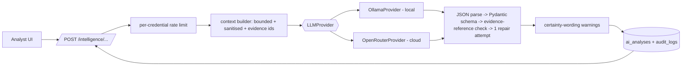
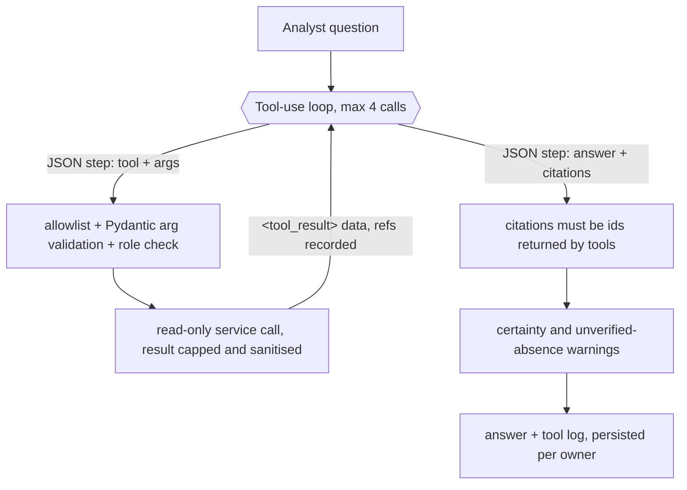

# AI Architecture

AI **explains**; deterministic rules **decide**. Nothing in `app/intelligence` can create, modify, re-score, dismiss or
close a detection, and nothing the model returns is written to anomaly, evidence or investigation records.

## Provider abstraction
`LLMProvider` (`generate`, `generate_structured`, `health_check`, `list_models`) with `OllamaProvider` and
`OpenRouterProvider`. The same workflow, prompts and validation run on either; the analyst can pick provider and model
per request, and an admin can change the default at runtime (`PUT /settings/ai`).
Configuration is environment-driven (`AI_PROVIDER`, `OLLAMA_BASE_URL`, `OLLAMA_MODEL`, `OPENROUTER_API_KEY`,
`OPENROUTER_MODEL`, `AI_TIMEOUT_S`, `AI_MAX_OUTPUT_TOKENS`, `AI_MAX_CONTEXT_CHARS`, `AI_RATE_LIMIT_PER_MINUTE`).
**No model name or key is hardcoded.** API keys and endpoint URLs are environment-only: the settings API can change
provider and model names but never a URL (no SSRF) or a secret.

## Features in this phase
| Feature | Endpoint | Output (validated) |
|---|---|---|
| Anomaly explanation | `POST /intelligence/anomaly-explanation` | what happened, rule triggered, cited evidence, alternatives, relevance, next steps, limitations |
| Aircraft investigation assistant | `POST /intelligence/aircraft-investigation` | activity summary, unusual observations with refs, explanations, security implications, recommendations, limitations |
| History | `GET /intelligence/analyses` | stored analyses, shown beside the **current** detection state |
| Provider config | `GET/PUT /settings/ai` | health, model lists, defaults (admin to change) |

| Conversational assistant | `POST /intelligence/chat`, `GET /intelligence/conversations[/{id}]` | final answer + validated citations + the tool calls used |
| Threat-intelligence correlation | `POST /intelligence/threat-correlation` | four separated layers (see below) + the documents supplied |
| Reports | `POST/GET /intelligence/reports`, `GET .../{id}/export?format=md\|pdf` | sections each labelled VERIFIED PLATFORM DATA or AI-GENERATED, UNVERIFIED |
| Threat-intel store | `GET/POST /threat-intel`, `POST /threat-intel/import/arxiv` | documents with source, URL, dates, excerpt, reliability limits |

## Security controls
| Threat | Control |
|---|---|
| **Prompt injection** from feed data (callsigns, payload text) | Context is JSON inside one `<data>` block; untrusted strings are stripped of control characters, `<`/`>` are neutralised so data cannot close the block, lengths are capped. The system prompt states the data is untrusted and instructions inside it must never be followed. Verified with a test where a callsign contains `</data>` plus instructions and a deliberately obedient fake model. |
| Model changes state | It has **no tools** in this phase and its output is never persisted outside `ai_analyses`. Test: after an "obedient" response, anomaly status/severity and audit log are unchanged. |
| Hallucinated evidence | Every cited reference (`E3`, `A2`, `AC`, `TRAJ`...) must exist in the supplied context; unknown ids trigger one repair attempt, then the request is rejected and recorded as `INVALID_OUTPUT`. |
| Malformed / oversized output | Pydantic schema with length limits; extras ignored (never stored); one repair attempt. |
| Overstated claims | Wording that presents a hypothesis as fact ("confirms a spoofing attack") is flagged to the analyst; hedged wording is not. Warnings, not blocks. |
| AI output taken for a finding | Every result carries `ai_generated: true` and a disclaimer; the UI labels it "AI-GENERATED INTERPRETATION - not a verified finding" and shows the unchanged deterministic detection beside it. |
| Cost / abuse | Analyst role required, per-credential limit (default 10/min), token and context limits, wall-clock deadline per cloud call. |
| Secret leakage | Key is read server-side only, sent solely as a bearer header to OpenRouter, never logged, never in responses or audit details (tests assert this); provider error messages are our own text, not upstream bodies. |
| Data egress | Default provider is local Ollama. The UI shows which provider will receive data; OpenRouter receives the sanitised context (anomaly evidence, aircraft summary, nearby airports), never tokens or user identities. |
| Auditability | Each request records requester, provider, model, prompt version, input size + SHA-256, token usage, latency, outcome; the audit log records usage and selection but **not** prompt or output text. |

## Measured with real providers (this deployment)
- **Ollama `qwen2.5:7b-instruct`** (local, 16 GB Mac): valid structured output first try; 31-92 s per explanation.
  `llama3.1` also valid (~10 s on a small probe). "Uncensored/abliterated" local models were deliberately not used.
- **OpenRouter free tier**: every free JSON-capable model on this key is a **reasoning model**. They spend the output
  budget thinking: with `AI_MAX_OUTPUT_TOKENS=1800` `ling-3.2-flash:free` and `nemotron-3.5-super-vl:free` returned empty
  content (`finish_reason=length`). The adapter now reports this explicitly. With a 6,000-token budget `ling-3.2-flash:free`
  produced a high-quality, correctly grounded explanation, but took **471 s**. Gemma free models were rate-limited upstream
  (429) throughout. Conclusion: free reasoning models work but are too slow for interactive use; use a paid
  non-reasoning model for the cloud provider, or Ollama.
- An overall wall-clock deadline is enforced (httpx timeouts are per read and a cloud call otherwise ran past its limit).
- nginx gives AI routes a 600 s read timeout (the default 30 s cut a real request off while the backend kept working).

## Limitations
- Small local models give thin, generic analysis; citation grounding is enforced, depth is not.
- Evidence references are validated in structured fields only; ids mentioned in free text are not checked.
- Requests are synchronous (the UI shows elapsed time). Long cloud jobs would need a background-job design.
- Output quality has not been evaluated systematically; no accuracy claim is made.
- The in-process rate limiter is single-worker.

## Phase 7: assistant, correlation, reports

### Controlled tools (no SQL, no writes)
Nine read-only tools only: `search_aircraft`, `get_aircraft_history`, `get_aircraft_anomalies`, `search_anomalies`,
`get_emergency_events`, `get_airport_statistics`, `get_flight_trajectory`, `generate_investigation_summary` (deterministic, no
LLM) and `search_threat_intel`. Arguments are validated with `extra="forbid"`, strict patterns and hard caps (rows, windows,
radius); results are size-capped, sanitised and carry the record ids they expose. Unknown tools, invalid arguments and role
violations come back to the model as tool errors (it may correct itself), never as server errors. There is no tool that can
change a status, add a note, or run arbitrary queries, so a successful injection could at worst influence the *text* of an
answer. Tool usage is audited (name and arguments, not results). Conversations are private to their creator (admins may
view); history replays only questions and final answers, never raw tool output.

### Grounding checks
- Citations in a final answer must be ids that appeared in tool results this conversation (`ANM-0056`, `AC:440604`,
  `DOC:3`, ...). Violations trigger a repair, then rejection.
- **Unverified absence claims are flagged.** After a real failure (a local model asserted "no HIGH detections for this
  aircraft" without querying them), any "no/none/zero..." statement is flagged unless some tool call actually returned an empty
  result. A fleet-wide `search_anomalies` tool was added because the model had no way to express that query.
- Answers with no retrieved records are flagged as general information.

### Threat-intelligence correlation: four layers, enforced
| Layer | Allowed citations | Enforcement |
|---|---|---|
| verified_observations | platform records only (`E*`, `RULE`, `AC`, `A*`) | strict: citing a document is rejected |
| external_facts | supplied documents only (`D*`) | strict; must be empty when no documents were supplied |
| analytical_hypotheses | observations and/or documents | graceful: ungrounded ones are removed and counted |
| ai_interpretation | n/a | labelled AI-generated |

Documents come from a full-text search of the stored intel and are always marked as research context, not evidence about this data.

### Threat-intelligence store
Each item requires source name, https URL, publication date (when known), retrieval time, excerpt (abstract or analyst summary,
never full text) and a reliability statement. Sources: manual registration, and arXiv's **documented public API**
(abstracts only; the XML response is parsed with `defusedxml` and verified to reject entity-expansion and external-entity
payloads). No websites are scraped.

### Reports
Built from stored records plus (optionally) *existing* AI analyses, so generating a report never silently triggers a model
call. The executive summary is always deterministic; AI content only ever appears in sections tagged AI-GENERATED, UNVERIFIED,
and the whole report is marked UNREVIEWED. Markdown is escaped so untrusted text cannot inject formatting or links; PDF text is
XML-escaped and reduced to Latin-1; exports are served as attachments with `nosniff` and `no-store`.

### Measured with the real local model (qwen2.5:7b-instruct)
- Tool-using chat works: correct tool choice and a correct, cited answer for emergencies and for research documents (20-33 s).
- Known failure modes of small models, all observed: a missing-argument tool call (recovered via the error loop), an
  unverified absence claim (now flagged), and **semantic mix-ups that pass every structural check** (it attributed another
  aircraft's detection to N722BD, then contradicted itself; in correlation it presented other detections as "verified
  observations" with an unrelated citation and ignored the documents). Citation validation proves an id exists, not that it
  supports the claim. Use a stronger model for anything beyond demonstration, and always verify cited records.
- Correlation needed 3 attempts and ~107 s; one call exceeded a 120 s timeout while the machine was busy, so `AI_TIMEOUT_S`
  is raised for local models in this deployment.

### Limitations
- No semantic verification of claims against cited records; no systematic evaluation or accuracy claim.
- The tool loop is synchronous; several model calls per question means minutes with a local model.
- Free-text mentions of record ids are not validated (only structured citation fields).
- Threat intelligence is only as good as what has been imported (7 arXiv abstracts here); there are no incident feeds.
- Reports do not embed maps/charts.
