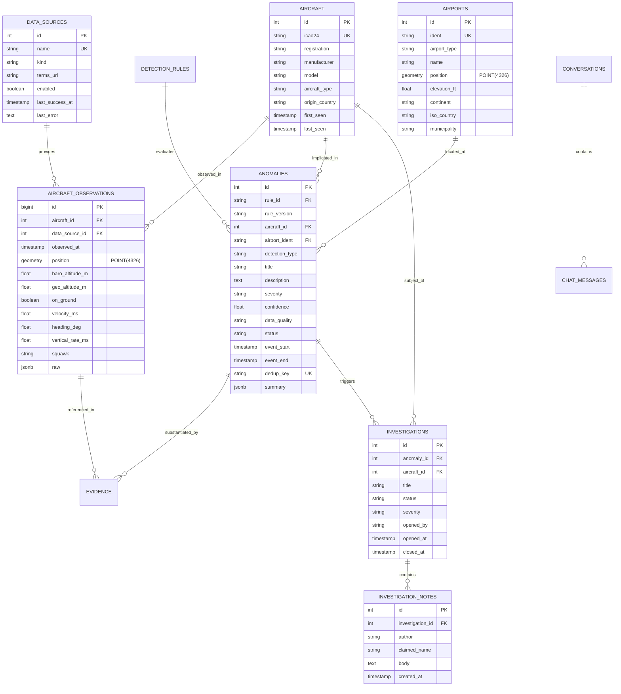

# AeroSecurity AI — System Architecture

## 1. High-Level Architecture Overview

AeroSecurity AI is built as a **modular monolith** optimized for aviation intelligence, real-time ADS-B observation processing, geospatial analytics, deterministic cyber-physical anomaly detection, and AI-assisted investigation workflows.

```mermaid
flowchart TD
    subgraph DataSources["External Aviation Data Sources (Untrusted)"]
        OS_CSV["OpenSky Network (Historical Datasets)"]
        OS_REST["OpenSky REST API (Live Feed)"]
        OA_CSV["OurAirports Global Airport Database"]
        AC_META["OpenSky Aircraft Metadata Database"]
        ARXIV["ArXiv Cybersecurity Research Feed"]
    end

    subgraph Ingestion["Ingestion & Normalisation Engine"]
        PROV["Provider Abstraction Layer"]
        VAL["Schema Normaliser & Range Validator"]
        DEDUP["Idempotent Deduplication (PostGIS Batch Upsert)"]
    end

    subgraph Persistence["Persistence Layer (PostgreSQL 16 + PostGIS 3.4)"]
        DS_TBL[("data_sources")]
        AC_TBL[("aircraft")]
        OBS_TBL[("aircraft_observations (POINT 4326)")]
        AP_TBL[("airports (POINT 4326)")]
        AN_TBL[("anomalies & evidence")]
        INV_TBL[("investigations & investigation_notes")]
        INT_TBL[("threat_intelligence")]
        REP_TBL[("intelligence_reports")]
        AUD_TBL[("audit_logs")]
    end

    subgraph AnalyticsEngine["Aviation Analytics & Trajectory Engine"]
        GEO["Geodesic Geometry (Haversine & Azimuth)"]
        TRAJ["Trajectory Segmenter (dt, Derived Speed, Vertical Rate)"]
        GAP["Observation Gap & Teleport Detector"]
        METRICS["Fleet & Flight Distributions Engine"]
    end

    subgraph DetectionEngine["Deterministic Detection Engine (Rules DET-001 - DET-008)"]
        DET001["DET-001: Impossible Position Transition"]
        DET002["DET-002: Implausible Velocity & Acceleration"]
        DET003["DET-003: Altitude & Divergence Anomaly"]
        DET004["DET-004: Multi-Source Duplicate ICAO24"]
        DET005["DET-005: Emergency Squawk (7500/7600/7700)"]
        DET006["DET-006: Data Integrity & Inverted Timestamps"]
        DET007["DET-007: Trajectory Anomalies (MAD Outliers/Loitering)"]
        DET008["DET-008: Abnormal Airport Traffic"]
        PERSIST_DET["Idempotent Anomaly Persistence"]
    end

    subgraph AIEngine["AI Aviation Intelligence Layer"]
        LLM_PROV["Provider Interface (Ollama / OpenRouter)"]
        READONLY_TOOLS["Sandboxed Read-Only Investigation Tools"]
        OUTPUT_VAL["Structured JSON Output & Schema Validator"]
        CORRELATION["Cybersecurity Literature Correlation"]
    end

    subgraph APILayer["FastAPI Application Services (/api/v1)"]
        R_SYS["/system (Health, Liveness, DB/PostGIS Checks)"]
        R_AV["/aviation (Aircraft, Live Radar, History, Airports)"]
        R_AN["/analytics (Overview, Fleet Distributions, Trajectories)"]
        R_DET["/anomalies (Detections, Rules, Emergencies)"]
        R_INV["/investigations (Case Management, Evidence, Notes)"]
        R_AI["/intelligence & /assistant (Chat, Reports, Literature)"]
    end

    subgraph Frontend["Aviation Operations Interface (React 19 + MapLibre GL)"]
        DASH["Overview / Operations Dashboard"]
        RADAR["Live Radar & Flight Map"]
        AC_INTEL["Aircraft Intelligence Center"]
        TRAJ_UI["Trajectory & Dynamics Analytics"]
        ANOM_UI["Anomaly Center & Triage"]
        EMERG_UI["Emergency Squawk Monitoring"]
        AP_UI["Airport Intelligence & Traffic"]
        INV_UI["Investigation Center & Dossiers"]
        AI_UI["AI Assistant & Intelligence Reports"]
        SET_UI["Data Sources & System Settings"]
    end

    DataSources --> Ingestion
    Ingestion --> Persistence
    Persistence --> AnalyticsEngine
    Persistence --> DetectionEngine
    DetectionEngine --> Persistence
    Persistence --> APILayer
    AnalyticsEngine --> APILayer
    Persistence --> AIEngine
    AIEngine --> APILayer
    APILayer --> Frontend
```



---

## 2. Invariant Architectural Principles

1. **Deterministic Primacy:** Detections are produced exclusively by transparent, versioned mathematical rules. AI models never invent, modify, or suppress detection verdicts.
2. **Strict Separation of Reported vs. Derived Parameters:**
   - Provider-reported parameters (`velocity_ms`, `vertical_rate_ms`, `heading_deg`) represent what the transponder broadcasts.
   - Derived parameters (`derived_speed_ms`, `derived_vertical_rate_ms`, `derived_bearing_deg`) represent kinematic quantities computed from consecutive spatial fixes and elapsed time $\Delta t$.
   - These are stored in separate attributes and never confused.
3. **Immutability of Evidence:** Raw provider observation payloads are stored as JSONB evidence in `aircraft_observations.raw` and linked directly into `evidence` records.
4. **Data Provenance:** Every observation and threat intel document explicitly links to a valid `data_sources` record with registration timestamps, retrieval timestamps, and terms of use.
5. **No Data Fabrication:** Unknown values (e.g. absent registration, operator, or aircraft type) are maintained strictly as `NULL` and displayed as `—`. The system never synthesizes aircraft identities.
6. **Timezone Uniformity:** All timestamps are strictly UTC (`timestamptz`) with ISO-8601 formatting.
7. **Principle of Least Privilege:**
   - Role-based access control with static tokens (`VIEWER` < `ANALYST` < `ADMIN`).
   - Mutations (investigation updates, note creation, status transitions, report generation) require `ANALYST` or `ADMIN`.
   - AI tools run in a sandboxed, read-only environment without direct database mutation access.

---

## 3. Storage Architecture & PostGIS Schema

The PostgreSQL database leverages PostGIS geometry extensions (`SRID=4326`, WGS84 coordinates) and high-performance indexing:



---

## 4. Layer Communication & API Contracts

- **API Versioning:** All endpoints sit under `/api/v1/`.
- **Envelope Standard:** Single error envelope for all failures:
  ```json
  {
    "error": {
      "code": "NOT_FOUND",
      "message": "Resource not found",
      "details": {}
    }
  }
  ```
- **Paging Protocol:** Standardized pagination structure:
  ```json
  {
    "items": [],
    "total": 100,
    "limit": 50,
    "offset": 0
  }
  ```
- **GeoJSON Compatibility:** Geospatial points and trajectories output coordinates as `[longitude, latitude]` per GeoJSON RFC 7946 specifications.
