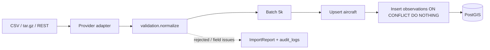

# Data Sources

Every record in the database references a `data_sources` row (provenance). Providers implement
`app.ingestion.base.ObservationProvider`; the detection engine only reads stored observations and never
depends on a provider.

| Source | Kind | Default | Licence / terms | Used for |
|---|---|---|---|---|
| `opensky-dataset` | dataset (CSV / `.tar.gz`) | enabled | OpenSky research data, CC BY 4.0 — cite Schaefer et al. (2014), "Bringing up OpenSky" | Aircraft observations (offline) |
| `opensky-api` | api (REST `states/all`) | **disabled** | [OpenSky terms](https://opensky-network.org/about/terms-of-use) restrict operational/commercial use | Live observations, only after operator authorisation |
| `opensky-aircraft-db` | dataset (CSV, ~108 MB) | enabled | OpenSky aircraft database: crowdsourced, provided as-is, no guarantees | Registration / type / model for **observed** aircraft only |
| `ourairports` | dataset (CSV) | enabled | Public domain | Airport reference data |

Planned, not yet implemented: ADS-B Exchange, FAA, BTS.

## Obtaining data

```bash
python scripts/fetch_datasets.py     # airports.csv + OpenSky incident extract (flydubai FZ1073, 2026-09-30)
docker compose exec backend python -m app.ingestion.cli opensky-csv /srv/datasets/raw/opensky-fz1073_2026-09-30.tar.gz
docker compose exec backend python -m app.ingestion.cli airports   /srv/datasets/raw/airports.csv
docker compose exec backend python -m app.ingestion.cli aircraft-metadata /srv/datasets/raw/opensky-aircraft-db-2025-08.csv
```

`datasets/raw/*` is git-ignored; downloads are size-capped and are never extracted to disk or executed.

## Enabling the live OpenSky API

1. Confirm you are authorised under OpenSky's terms for your use.
2. Set `OPENSKY_CLIENT_ID` / `OPENSKY_CLIENT_SECRET` (OAuth2 client credentials; anonymous access works with the lowest limits).
3. `UPDATE data_sources SET enabled = true WHERE name = 'opensky-api';`
4. `python -m app.ingestion.cli opensky-api --bbox LAMIN LOMIN LAMAX LOMAX --polls N`

The adapter: caches the OAuth token and refreshes before expiry (and once on a 401); enforces
`OPENSKY_MIN_INTERVAL_S` between requests; backs off exponentially with jitter on 429/5xx/network errors,
honouring `X-Rate-Limit-Retry-After-Seconds`; caps response size; never logs credentials. The browser never
contacts providers.

## Ingestion semantics



- **Rejected** (not stored): invalid ICAO24, missing/invalid timestamp. Counted by reason in the report and audit log.
- **Stored with flags**: values that are impossible as numbers (NaN, negative speed, lat > 90, malformed squawk, heading > 360) are stored as NULL; the original value is kept in `raw.rejected_values` and the reason in `raw.issues` (input for DET-006).
- **Stored unchanged**: values that are merely *implausible* (e.g. very high speed). Plausibility is the detection engine's job (DET-001…003), so ingestion must not destroy that evidence.
- **`observed_at`** is the position-fix time (`lastposupdate` / `time_position`) when present, else the sample/last-contact time. Re-emitted copies of the same fix therefore collapse onto one row.
- **Idempotent**: unique `(aircraft_id, data_source_id, observed_at)`; a re-import inserts nothing. Skipped rows are counted as `duplicates`.
- **Absent stays NULL**; units are SI. Each run writes an `audit_logs` entry (`ingest.completed` / `ingest.failed`) and updates `data_sources.last_success_at` / `last_error` (credentials redacted).
- **Dataset safety:** regular file only (no symlinks), size and row limits, required-column check, exactly one `*state_vectors_data4.csv` archive member streamed in memory.

## Measured on the real FZ1073 extract

4,402 rows read → 3,233 stored (1,169 duplicate position fixes collapsed), 0 rejected, 6 rows without a position flagged `missing_coordinates`; re-import inserts 0. Observations span 03:05:36–05:53:32 UTC, matching the dataset's documented last contact (05:53:33). The dataset's own README notes coverage gaps and an unreliable broadcast `vertrate` field; these are data characteristics, not ingestion errors.

## Aircraft metadata

`aircraft-metadata` enriches only aircraft that already have observations (nothing is created). Placeholders
(`''`, `unknow`) stay NULL; `aircraft.metadata_source_id` records provenance. For the FZ1073 aircraft the
database supplies registration `A6-FKF` and type `B38M`, but no manufacturer/model/operator, which therefore
remain blank in the UI rather than being guessed. The source is crowdsourced and can be wrong.

## Findings from the real FZ1073 data (verified independently)

1. **Observation gaps.** Derived from positions: 4,476 s (74.6 min; 04:01:28Z to 05:15:55Z) and 563 s. The same
   values appear in both the `state_vectors_data4` and raw `position_data4` tables. The dataset README's prose
   quotes "69 minutes" and "252 seconds"; those figures do not match its own tables. This project reports what
   the data shows.
2. **Timestamp jitter.** 16 of ~3,200 segments show derived speeds of 300-1,182 m/s (the aircraft flew ~230 m/s).
   All have dt < 1 s: position timestamps jitter by up to ~1 s, so displacement/dt is unreliable for very short
   intervals. This is not evidence of spoofing and is a **design constraint for DET-001** (model timestamp
   uncertainty; do not trust sub-second intervals). The UI hides sub-second intervals from the derived-speed chart by default.
3. **Reported vs derived are different quantities** and are always shown separately.

## Incident extracts used for detection validation

Five OpenSky incident extracts (CC BY 4.0), one aircraft each, 7 h to 24 h windows: flydubai FZ1073 (`8965d1`),
Austrian OS82 (`440604`, bomb-threat diversion, squawk 7700), Learjet 60 N722BD (`a9ab17`), PA-46 N931TT
(`aceb1b`) and Learjet 55 XA-UCI (`0d086e`). The last three are fatal accidents under investigation; the
dataset READMEs state the data is "not an analysis and not evidence of a cause", and this project holds to that.
Each file de-duplicates re-emitted states and removes carried-forward positions (documented in its README).
