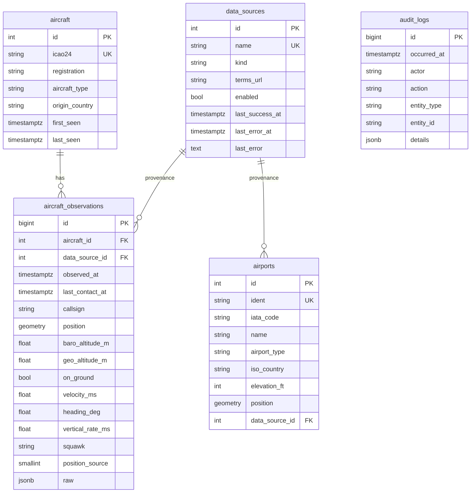

# Database Schema

PostgreSQL 16 + PostGIS 3.4. All timestamps `timestamptz` (UTC). Geometry is `POINT`, SRID 4326 (lon/lat).
Distances are computed with geography/haversine, never planar degrees.

## Implemented (migration 0001)

Design notes:
- **Identity vs time series:** `aircraft` holds one row per ICAO24 (CHECK `^[0-9a-f]{6}$`); observations are separate, append-only rows.
- **Idempotent ingestion:** `UNIQUE (aircraft_id, data_source_id, observed_at)` makes re-imports safe; duplicates are *also* a detection signal (DET-006), so ingestion must record rather than silently drop them (Phase 2 design item).
- **Indexes:** `(aircraft_id, observed_at)` for history/trajectory, `(observed_at)` for time windows, GiST on `position` for bounding-box and proximity queries.
- **Scale path:** if volume demands it, partition `aircraft_observations` by `observed_at` (monthly). Not done now to avoid premature complexity.
- **Nullable by design:** every provider-optional measurement is NULL when absent.
- `audit_logs` is append-only by convention; DB-level enforcement (revoked UPDATE/DELETE for the app role) is a Phase 8 hardening item.

## Implemented in migration 0002/0003

- `aircraft` gains `manufacturer`, `model`, `operator`, `metadata_source_id` (provenance of descriptive metadata) and a prefix-search index on `registration`; `aircraft_observations` gains a prefix-search index on `callsign`.
- `detection_rules(id PK 'DET-00x', name, description, version, enabled, config JSONB)`.
- `anomalies(id, rule_id FK, rule_version, aircraft_id FK | airport_ident, detection_type, title, description, severity, confidence, data_quality, status, event_start/end, detected_at, dedup_key, source_refs JSONB, summary JSONB)` with CHECK constraints (severity/status/data_quality enums, confidence 0..1, exactly-one-subject) and `UNIQUE(rule_id, rule_version, dedup_key)`.
- `evidence(id, anomaly_id FK CASCADE, ordinal, kind, observation_id FK SET NULL, payload JSONB)`.

## Planned (added with the phase that needs them)

| Table | Phase | Notes |
|---|---|---|
| `flights` | 3 | Derived segments, with documented inference method |
| `investigations`, `investigation_notes` | 5 | Status OPEN/INVESTIGATING/FALSE_POSITIVE/RESOLVED; every change audited |
| `ai_analyses` | 6 | Provider, model, prompt version, validated output, labelled AI-generated |
| `threat_intelligence` | 7 | Source name/URL, publication date, retrieval time, excerpt, reliability limits |
| `intelligence_reports` | 7 | Structured sections, export metadata |
