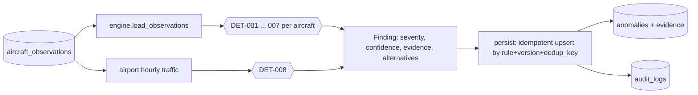

# Detection Rules

All detection is **deterministic and rule-based**. AI never decides, changes or suppresses a detection (it may
only explain one, Phase 6). Every rule is a pure function (`app/detection/rules/`), independently unit-tested,
versioned, and configurable (`detection_rules.config` JSONB; unknown keys are rejected).

## Output contract (enforced for every finding by `tests/detection/test_contract.py`)

| Field | Meaning |
|---|---|
| `anomaly_id` | `ANM-%04d` derived from the row id |
| `rule_id`, `rule_version` | which rule and which version produced it (reproducibility) |
| `detection_type`, `title`, `description` | what was observed, in data terms |
| `icao24` **or** `airport_ident` | exactly one subject |
| `severity` | LOW / MEDIUM / HIGH / CRITICAL |
| `confidence` ∈ [0,1] | confidence that the **data pattern is real as described**. It is **not** the probability of malicious activity |
| `data_quality` | GOOD / PARTIAL (missing inputs, non-ADS-B source, gap) / DEGRADED (finding is about defective data) |
| `evidence` | ordered items: `observation` (linked to a stored row), `metric` (computed values + thresholds + tolerances), `context` |
| `summary.alternative_explanations` | benign and non-benign explanations; never empty |
| `status` | OPEN / INVESTIGATING / FALSE_POSITIVE / RESOLVED (transitions and audit arrive in Phase 5) |
| `source_refs` | data sources involved |

Findings never assert intent or cause (the contract test forbids words like "attack", "malicious", "crash").

### Persistence semantics
`UNIQUE(rule_id, rule_version, dedup_key)`. Re-running is idempotent. If an **open** finding's content changes
(e.g. an emergency episode grows) it is updated in place and its evidence replaced; findings an analyst has moved
to FALSE_POSITIVE/RESOLVED are **never rewritten**. Behaviour-affecting rule changes must bump the rule version
(new version = new findings; old ones remain).

### Tolerances measured on real data
Position timestamps in real OpenSky data jitter by up to ~1 s (16 segments in one flight implied 300-1,182 m/s for a
~230 m/s aircraft; all had dt < 1 s). Distance rules therefore use the **most favourable** reading:
`lower_bound_speed = max(0, d - 2*position_unc) / (dt + timestamp_unc)` (defaults: 100 m per fix, 1 s).

## Rules

| ID | Type | Key logic | Severity / confidence |
|---|---|---|---|
| **DET-001** Impossible Position Transition | POSITION_ANOMALY | Consecutive positions whose tolerance-adjusted lower-bound speed exceeds 1,000 m/s (HIGH) or the 350 m/s civil ceiling **and** 2x the reported speed (MEDIUM). Jumps within 60 s form one episode (out-and-back outliers = 1 finding). Long gaps are judged by average speed. | Confidence from margin (0.5 at threshold, +0.15 per doubling); -0.15 non-ADS-B source (MLAT/ASTERIX/FLARM), -0.10 across a gap, -0.05 no reported speed |
| **DET-002** Implausible Velocity | VELOCITY_ANOMALY | Reported speed above a per-type ceiling (`type_limits_ms`, default 350; deliberately small/incomplete table, extend per deployment) or acceleration > 25 m/s² (timestamp-tolerant). Unknown type => PARTIAL. | ratio >2 HIGH, >1.3 MEDIUM, else LOW; accelerations MEDIUM |
| **DET-003** Altitude Anomaly | ALTITUDE_ANOMALY | (a) baro change > 100 m/s lower bound; (b) reported vertical rate > 2x what the altitude series supports; (c) |geo - baro| > 1,500 m (HIGH > 3,000 m); (d) on-ground flag with baro > 6,000 m; (e) >= 10 airborne positions with no altitude. Baro and geometric altitude are never treated as ground truth for each other. Missing baro **on the ground is normal** and not flagged. | (b) capped 0.75 because the broadcast vertical-rate field is noisy; (c) capped 0.8 |
| **DET-004** Duplicate ICAO24 | IDENTITY_CONFLICT | (i) different sources within 5 s whose positions cannot be reconciled; (ii) within one source, >= 3 impossible hops that reverse direction (A->B->A->B). Reported as an **identity conflict**, never as spoofing. | MEDIUM; PARTIAL |
| **DET-005** Emergency Squawk | EMERGENCY_SQUAWK | 7500 CRITICAL, 7700 HIGH, 7600 MEDIUM. Episodes merge observations <= 300 s apart. Event record: aircraft, code, first/last time, last known position, sources, sampled history. A single observation is marked **transient** (code may be passing through while dialled) with confidence <= 0.3. | 0.55-0.95 by persistence |
| **DET-006** Data Integrity | DATA_INTEGRITY | Runs of observations without position, ingestion-flagged invalid fields, last-contact earlier than position time, timestamps later than ingestion, identical fixes from multiple sources. | LOW (MEDIUM for future timestamps); DEGRADED |
| **DET-007** Unusual Trajectory | TRAJECTORY_ANOMALY | Robust statistics (median/MAD) against the aircraft's **own** history (needs >= 300 positions and >= 10 min, else no finding): 30 s turn rate > 6 deg/s and robust z > 8; or >= 540 deg net rotation within 15 min inside an 8 km radius (orbit/loiter). No ML. | LOW; confidence <= 0.6; holds/training listed as alternatives |
| **DET-008** Abnormal Airport Traffic | AIRPORT_TRAFFIC | Hourly distinct aircraft within 10 km vs the airport's own baseline (>= 24 observed hours): count >= 5, >= 2x median, robust z > 6. **Only increases are reported** - a drop is indistinguishable from a receiver outage. | LOW; confidence <= 0.5; "does not indicate a security incident" |

## Validation on real data (5 aircraft, 39,486 observations; `tests/test_integration_detection.py`)

| Rule | Result | Interpretation |
|---|---|---|
| DET-001 | 0 | Real timestamp jitter is absorbed. Without tolerances it would have produced false 1,000+ m/s "teleports". |
| DET-002 | 7 | OS82: one 440 m/s velocity glitch on an A320 plus accelerations of 62-138 m/s^2. N931TT (PA-46): reported speeds of 130-175 m/s, above the 120 m/s type ceiling. |
| DET-003 | 3 | N722BD (Learjet): altitude change 190 m/s, reported vertical rate 166 m/s unsupported by altitude, baro/geo divergence -3,805 m (others stay within ~1 km). |
| DET-004 | 0 | Expected: one source cannot conflict with itself. |
| DET-005 | 1 | OS82 squawked 7700 for 212 observations between 18:27:10 and 18:34:03 UTC. |
| DET-006 | 12 | Short runs of positionless observations; 4 last-contact-before-position records. |
| DET-007 | 0 | Real data peaks at 4.5 deg/s (30 s average) and 513 deg net rotation: below the floors. Thresholds were **not** tuned to produce findings. |
| DET-008 | 0 | 258 nearby airports evaluated; no airport has >= 24 observed hours. Covered by synthetic tests only. |

Several of these aircraft were involved in fatal accidents under investigation by the NTSB. The platform reports
what the data shows (with alternatives, including genuine extreme flight conditions); it makes **no claim about
cause** and these outputs are not findings of any investigation.

## Known limitations
- No velocity-vs-displacement consistency check over longer windows (a classic spoofing indicator); roadmap.
- DET-004 cross-source logic needs multiple providers; only one provider is wired today, so it is validated on synthetic data.
- DET-007/008 baselines need history; DET-008 is untested on real data for lack of multi-day multi-aircraft coverage.
- The type-limit table in DET-002 is minimal. "Inconsistent observation metadata" in DET-006 currently covers
  timestamp/last-contact and cross-source duplication only.
- Receiver coverage, not just aircraft behaviour, shapes every statistic. Nothing here has been validated against
  labelled attack data; **no detection-accuracy claim is made**.
